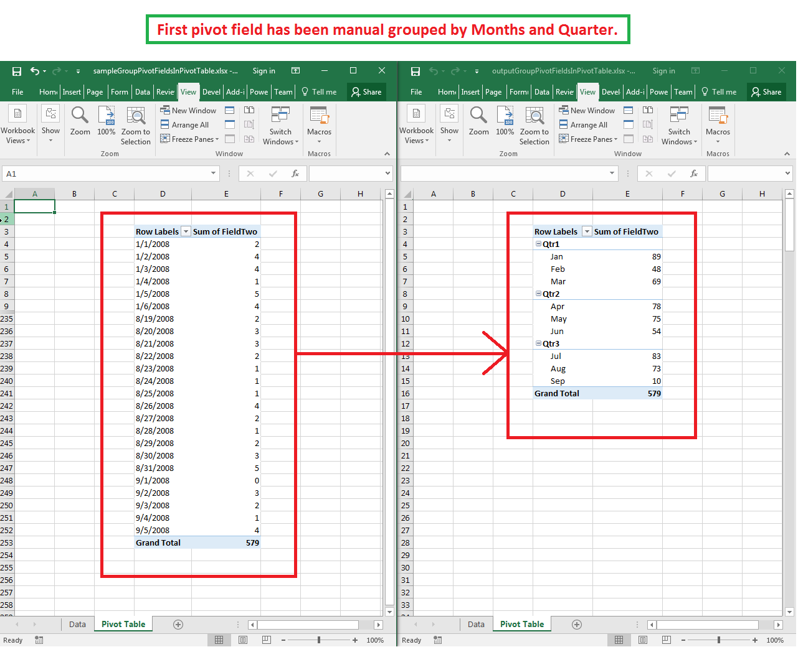

## **Possible Usage Scenarios**
- Grouping pivot fields is useful when a row or column field of a pivot table contains many distinct items, such as a date field with hundreds of dates or a numeric field with many scattered values. Grouping collapses these items into meaningful sections: dates into months, quarters and years, and numbers into ranges such as 0-1, 2-3, 4-5. This makes a large pivot table compact and easier to analyze. Aspose.Cells provides this capability through the `PivotField.Group()` method (automatic grouping by data type) and `PivotField.Group(PivotFieldGroupOptions)` (custom grouping options).
- Date grouping rolls the individual dates up into larger periods, such as days, months, quarters and years, and builds a time hierarchy (for example Years, Quarters, Months). Trends over time become visible at a glance, and each period level becomes its own pivot field in the row or column area of the pivot table.
- Grouping is available only for fields placed in the ROW or COLUMN area of a pivot table. A data (value) field cannot be grouped directly. To group such a field you must first add it to the row or column area of the pivot table.

## **Group Pivot Fields Automatically**
The parameterless `PivotField.Group()` overload inspects the data type of the field and groups it automatically. A field that contains only dates (and blanks) is grouped by months. A field that contains only numbers (and blanks) is grouped into numeric ranges using an automatic interval.

```go
package main
import (
	. "github.com/aspose-cells/aspose-cells-go-cpp/v26"
)
func main() {
	// Load the sample workbook containing the pivot table
	workbook, _ := NewWorkbook_String("sampleGroupPivotFieldsInPivotTable.xlsx")
	worksheets, _ := workbook.GetWorksheets()
	worksheet, _ := worksheets.Get_Int(1)
	pivotTables, _ := worksheet.GetPivotTables()
	pivotTable, _ := pivotTables.Get_Int(0)
	// Group the first row field automatically by its data type
	rowFields, _ := pivotTable.GetRowFields()
	field, _ := rowFields.Get_Int(0)
	field.Group()
	pivotTable.CalculateData()
	workbook.Save_String("outputAutoGroupPivotField.xlsx")
}
```

## **Group Pivot Fields with Custom Options**
The `PivotFieldGroupOptions` class provides custom grouping configuration. For date fields, set `StartDate`, `EndDate`, and `GroupTypes` (dates are passed as Go `time.Time` values). For numeric fields, set `StartNumber`, `EndNumber`, and `Interval`. The `newPivotField` behavior controls whether grouping creates new pivot fields alongside the original (see the Note section at the end of this article).

### **Group a Date Field by Months and Quarters**
The following example groups the date row field of the sample pivot table by months and quarters between a start and end date. The code loads the [sample Excel file](sampleGroupPivotFieldsInPivotTable.xlsx), performs the grouping, calculates the pivot table data, and saves the grouped result. The screenshot shows the effect: the date row field is now grouped by quarters and months.
Note that the order of the values in `GroupTypes` is ignored. No matter in which order the group types are listed, the grouped fields are always displayed from the largest period to the smallest: years, quarters, months, days, hours, minutes, seconds. In this example the months are listed before the quarters in `GroupTypes`, yet the quarters are displayed as the outer level and the months as the inner level.

```go
package main
import (
	"time"
	. "github.com/aspose-cells/aspose-cells-go-cpp/v26"
)
func main() {
	// Load the sample workbook containing the pivot table
	workbook, _ := NewWorkbook_String("sampleGroupPivotFieldsInPivotTable.xlsx")
	worksheets, _ := workbook.GetWorksheets()
	worksheet, _ := worksheets.Get_Int(1)
	pivotTables, _ := worksheet.GetPivotTables()
	pivotTable, _ := pivotTables.Get_Int(0)
	// Group the date row field by months and quarters between the given dates
	options, _ := NewPivotFieldGroupOptions()
	options.SetStartDate(time.Date(2008, 1, 1, 0, 0, 0, 0, time.UTC))
	options.SetEndDate(time.Date(2008, 9, 5, 0, 0, 0, 0, time.UTC))
	options.SetGroupTypes([]PivotGroupByType{PivotGroupByType_Months, PivotGroupByType_Quarters})
	rowFields, _ := pivotTable.GetRowFields()
	dateField, _ := rowFields.Get_Int(0)
	dateField.Group_PivotFieldGroupOptions(options)
	pivotTable.CalculateData()
	workbook.Save_String("outputGroupPivotFieldsInPivotTable.xlsx")
}
```



### **Group a Numeric Field into Ranges**
`FieldTwo` of the sample pivot table is initially a data (value) field. Because only row or column fields can be grouped, the code first calls `PivotTable.AddFieldToArea(PivotFieldType_Row, "FieldTwo")` to move `FieldTwo` to the row area, refreshes the pivot, then groups the numeric field into the ranges 0-1, 2-3 and 4-5 using `StartNumber = 0`, `EndNumber = 5` and `Interval = 2`.

```go
package main
import (
	. "github.com/aspose-cells/aspose-cells-go-cpp/v26"
)
func main() {
	// Load the sample workbook containing the pivot table
	workbook, _ := NewWorkbook_String("sampleGroupPivotFieldsInPivotTable.xlsx")
	worksheets, _ := workbook.GetWorksheets()
	worksheet, _ := worksheets.Get_Int(1)
	pivotTables, _ := worksheet.GetPivotTables()
	pivotTable, _ := pivotTables.Get_Int(0)
	// FieldTwo is a data field: move it to the row area first,
	// because only row/column fields can be grouped
	pivotTable.AddFieldToArea_PivotFieldType_String(PivotFieldType_Row, "FieldTwo")
	pivotTable.CalculateData()
	// Group the numeric field into the ranges 0-1, 2-3, 4-5
	options, _ := NewPivotFieldGroupOptions()
	options.SetStartNumber(0)
	options.SetEndNumber(5)
	options.SetInterval(2)
	rowFields, _ := pivotTable.GetRowFields()
	numericField, _ := rowFields.Get_Int(1)
	numericField.Group_PivotFieldGroupOptions(options)
	pivotTable.CalculateData()
	workbook.Save_String("outputNumberGroupPivotField.xlsx")
}
```

## **Note**

{}
- The `PivotField.GroupBy()` method overloads are deprecated and removed from the API surface. `PivotField.Group()` and `PivotField.Group(PivotFieldGroupOptions)` are the replacements.
- In Microsoft Excel, grouping a numeric field REPLACES the original pivot field with the grouped ranges, while grouping a date field creates NEW pivot fields (one per group level, for example Quarters and Months) beside the original field. Starting with Aspose.Cells 26.10, the `PivotField.Group()` methods follow the same behavior as Excel.
- The `PivotFieldGroupOptions.Interval` property takes effect only for numeric grouping and for date grouping by days (for example, grouping dates into 7-day periods); it is ignored when dates are grouped by months, quarters or years.
{}

## **Related Articles**
- [Top 10 Show or Filter in Pivot Table](/cells/go-cpp/top-10-show-or-filter-in-pivot-table/)
- [Show Values As in Pivot Table](/cells/go-cpp/show-values-as-in-pivot-table/)
- [Format Part of Pivot Table](/cells/go-cpp/format-part-of-pivot-table/)
- [Add Conditional Formatting to Pivot Table](/cells/go-cpp/add-conditional-formatting-to-pivot-table/)

