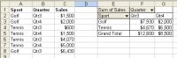

## **What is a Pivot Table?**
A pivot table is an interactive summary report: it condenses a large block of raw, row-by-row data into a compact matrix without a single formula. You decide which columns become row labels, which become column labels and which are aggregated as values — the pivot table does the grouping and the math:
- **Summarize** — total sales per product, per region or per quarter instead of long formula chains.
- **Compare** — categories on the rows and periods on the columns turn a flat list into a cross report where trends are visible at a glance.
- **Drill down** — double-click any summary value to inspect the source rows behind it.
- **Refresh** — when the source data changes, one refresh recalculates the whole report.
Typical scenarios are sales dashboards, expense breakdowns and inventory analysis — any question of the form "how do these numbers break down by category and time?". Aspose.Cells for Java builds the same pivot tables programmatically, so the workbooks your application generates can carry ready-made reports instead of raw data only.

### **Create Pivot Table Using Aspose.Cells**

{}
With Aspose.Cells, it is possible to add pivot tables to spreadsheets. Aspose.Cells has a number of special classes used specifically to create and control pivot tables. These classes are used to create and set the properties of a [**PivotTable**](https://reference.aspose.com/cells/java/com.aspose.cells/PivotTable) object, used as the pivot table building blocks.
The pivot table objects are:
- [**PivotField**](https://reference.aspose.com/cells/java/com.aspose.cells/PivotField): it represents a field in a pivot table.
- [**PivotFieldCollection**](https://reference.aspose.com/cells/java/com.aspose.cells/PivotFieldCollection): it represents a collection of all the [**PivotField**](https://reference.aspose.com/cells/java/com.aspose.cells/PivotField) objects in the pivot table.
- [**PivotTable**](https://reference.aspose.com/cells/java/com.aspose.cells/PivotTable): it represents a pivot table.
- [**PivotTableCollection**](https://reference.aspose.com/cells/java/com.aspose.cells/PivotTableCollection): it represents the collection of all the pivot table objects on the worksheet.
{}

### **Creating a Simple Pivot Table**
Creating a pivot table is a three-step recipe: write the source data into worksheet cells, add the pivot table at a destination position, and place the pivot fields into the row, column and data areas.
1. Add data to worksheet cells using the [**Cell**](https://reference.aspose.com/cells/java/com.aspose.cells/cell) object's [**setValue**](https://reference.aspose.com/cells/java/com.aspose.cells/cell#setValue-java.lang.Object-) method (`putValue` in most examples). This data will be used as the pivot table's data source.
2. Add a pivot table to the worksheet by calling the [**add**](https://reference.aspose.com/cells/java/com.aspose.cells/pivottablecollection#add-com.aspose.cells.PivotTable-int-int-) method of the [**PivotTableCollection**](https://reference.aspose.com/cells/java/com.aspose.cells/PivotTableCollection) class: `add(sourceData, row, column)`. `sourceData` is the source range (for example, "A1:C8"); `row` and `column` are the 0-based coordinates of the destination cell at the pivot table's upper-left corner (cell E3 means row 2, column 4). The method returns the new [**PivotTable**](https://reference.aspose.com/cells/java/com.aspose.cells/PivotTable) object directly.
3. Place the pivot fields with the [**PivotTable**](https://reference.aspose.com/cells/java/com.aspose.cells/PivotTable) object's `addFieldToArea` method: a field name goes to the row area (`PivotFieldType.ROW`), the column area (`PivotFieldType.COLUMN`) or the data area (`PivotFieldType.DATA`).
4. Save the workbook — the pivot table is written into the saved file.
The code example below creates a simple pivot table following these steps. When it executes, a pivot table based on the source data is added to the worksheet:


```java
import com.aspose.cells.*;
// Create a new workbook and get the first worksheet
Workbook workbook = new Workbook();
Worksheet sheet = workbook.getWorksheets().get(0);
Cells cells = sheet.getCells();
// Write the source data: sales per sport and quarter
cells.get("A1").putValue("Sport");
cells.get("B1").putValue("Quarter");
cells.get("C1").putValue("Sales");
cells.get("A2").putValue("Golf");
cells.get("B2").putValue("Qtr3");
cells.get("C2").putValue(1500);
cells.get("A3").putValue("Golf");
cells.get("B3").putValue("Qtr4");
cells.get("C3").putValue(2000);
cells.get("A4").putValue("Tennis");
cells.get("B4").putValue("Qtr3");
cells.get("C4").putValue(600);
cells.get("A5").putValue("Tennis");
cells.get("B5").putValue("Qtr4");
cells.get("C5").putValue(1500);
cells.get("A6").putValue("Tennis");
cells.get("B6").putValue("Qtr3");
cells.get("C6").putValue(4070);
cells.get("A7").putValue("Tennis");
cells.get("B7").putValue("Qtr4");
cells.get("C7").putValue(5000);
cells.get("A8").putValue("Golf");
cells.get("B8").putValue("Qtr3");
cells.get("C8").putValue(6430);
// Add a pivot table at destination cell E3, sourced from A1:C8
PivotTable pivotTable = sheet.getPivotTables().add("A1:C8", 2, 4);
// Assign pivot fields: Sport to Rows, Quarter to Columns, Sales to Data
pivotTable.addFieldToArea(PivotFieldType.ROW, "Sport");
pivotTable.addFieldToArea(PivotFieldType.COLUMN, "Quarter");
pivotTable.addFieldToArea(PivotFieldType.DATA, "Sales");
// Save the workbook
workbook.save("pivotTable_test_out.xlsx");
```

{}
When assigning a range of cells as the data source, the range must be set from the top left to the bottom right. For example, "A1:C3" is valid; "C3:A1" is invalid.
{}

