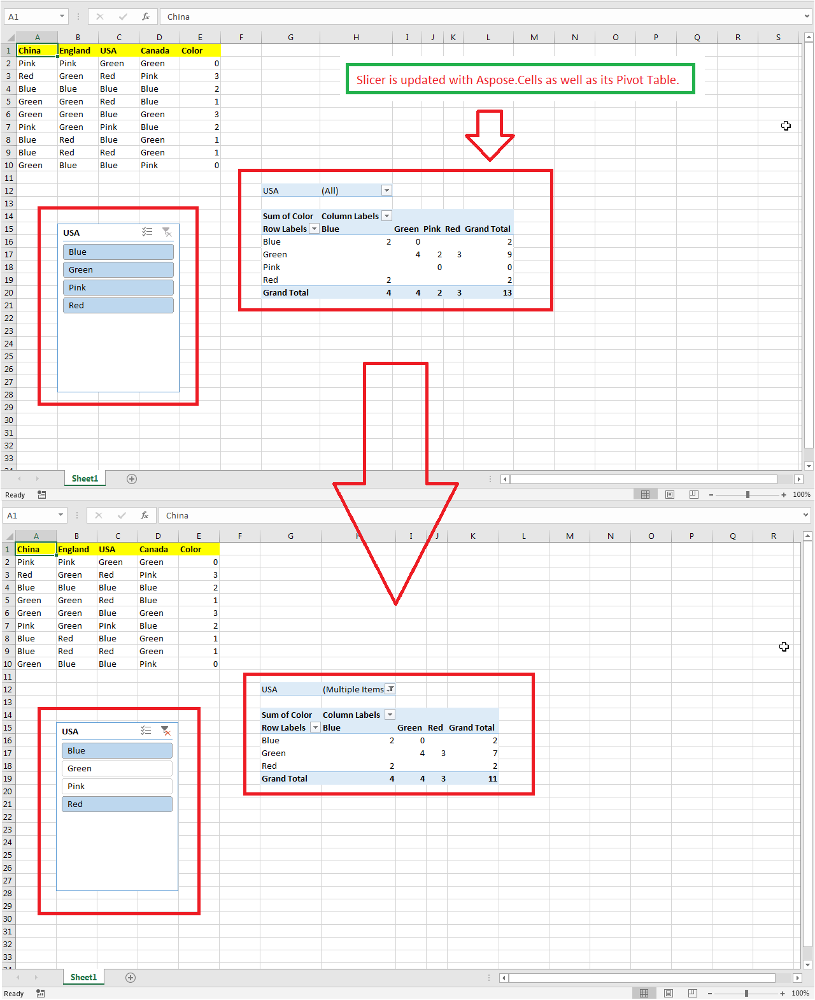

## **Possible Usage Scenarios**
Updating a slicer means filtering the data of the pivot table or table that the slicer is connected to. When you select or deselect slicer items in Microsoft Excel, the linked pivot table or table is recalculated accordingly. With Aspose.Cells for JavaScript via C++, you do not need to iterate the slicer cache items and refresh the slicer manually — the [**Slicer.selectItems(labels, append)**](https://reference.aspose.com/cells/javascript-cpp/slicer/) method updates the slicer and recalculates the linked pivot table or table directly from the filter items:
- `Slicer.selectItems(labels, append)` — selects the specified labels and recalculates the linked pivot table or table. When `append` is `true`, the originally selected labels are kept and the specified labels are added to the selection; when `append` is `false`, all original selections are cleared and only the specified labels stay selected.
- `Slicer.unselectItems(labels)` — unselects part of the currently selected items.
- `Slicer.clearFilter()` — removes the filter and selects all items.

{}
Starting from Aspose.Cells for JavaScript via C++ 26.10, the `SlicerCacheItem.selected` property becomes read-only and its setter is no longer supported. Use the `Slicer.selectItems`, `Slicer.unselectItems`, and `Slicer.clearFilter` methods instead of setting `SlicerCacheItem.selected` item by item.
{}

## **How to Update Slicer**
The following sample code loads the [sample Excel file](67338475.xlsx) that contains an existing slicer connected to a pivot table. It selects only the "Blue" and "Pink" items of the slicer with `Slicer.selectItems(labels, false)` — the pivot table is recalculated directly from the filter items, without a manual `Slicer.refresh()` call. It then saves the workbook as the [output Excel file](67338476.xlsx). The following screenshot shows the effect of the sample code on the sample Excel file. As you can see in the screenshot, the pivot table shows only the filtered items.


## **Sample Code**

```html
<!DOCTYPE html>
<html>
    <head>
        <title>Aspose.Cells Example - Update Slicer</title>
    </head>
    <body>
        <h1>Update Slicer Example</h1>
        <input type="file" id="fileInput" accept=".xls,.xlsx" />
        <button id="runExample">Run Example</button>
        <a id="downloadLink" style="display: none;">Download Result</a>
        <div id="result"></div>
    </body>
    <script src="aspose.cells.js.min.js"></script>
    <script type="text/javascript">
        const { Workbook, SaveFormat } = AsposeCells;
        AsposeCells.onReady({
            license: "/lic/aspose.cells.enc",
            fontPath: "/fonts/",
            fontList: [
                "arial.ttf",
                "NotoSansSC-Regular.ttf"
            ]
        }).then(() => {
            console.log("Aspose.Cells initialized");
        });
        document.getElementById('runExample').addEventListener('click', async () => {
            const fileInput = document.getElementById('fileInput');
            if (!fileInput.files.length) {
                document.getElementById('result').innerHTML = '<p style="color: red;">Please select an Excel file.</p>';
                return;
            }
            const file = fileInput.files[0];
            const arrayBuffer = await file.arrayBuffer();
            // Instantiate Workbook from uploaded file
            const workbook = new Workbook(new Uint8Array(arrayBuffer));
            // Access first worksheet
            const ws = workbook.worksheets.get(0);
            // Access the first slicer inside the slicer collection
            const slicer = ws.slicers.get(0);
            // Select only "Blue" and "Pink"; the linked pivot table or table
            // is recalculated directly from the filter items
            slicer.selectItems(["Blue", "Pink"], false);
            // Save modified workbook and provide download link
            const outputData = workbook.save(SaveFormat.Xlsx);
            const blob = new Blob([outputData]);
            const downloadLink = document.getElementById('downloadLink');
            downloadLink.href = URL.createObjectURL(blob);
            downloadLink.download = 'out.xlsx';
            downloadLink.style.display = 'block';
            downloadLink.textContent = 'Download Modified Excel File';
            document.getElementById('result').innerHTML = '<p style="color: green;">Slicer updated successfully! Click the download link to get the modified file.</p>';
        });
    </script>
</html>
```

Keep the currently selected labels and additionally select more items:

```javascript
// Keep the current selection and add "Red" to it.
slicer.selectItems(["Red"], true);
```

Deselect part of the selected items:

```javascript
// Remove "Pink" from the current selection.
slicer.unselectItems(["Pink"]);
```

Remove the filter (select all items):

```javascript
// Clear the filter; all slicer items become selected again.
slicer.clearFilter();
```

