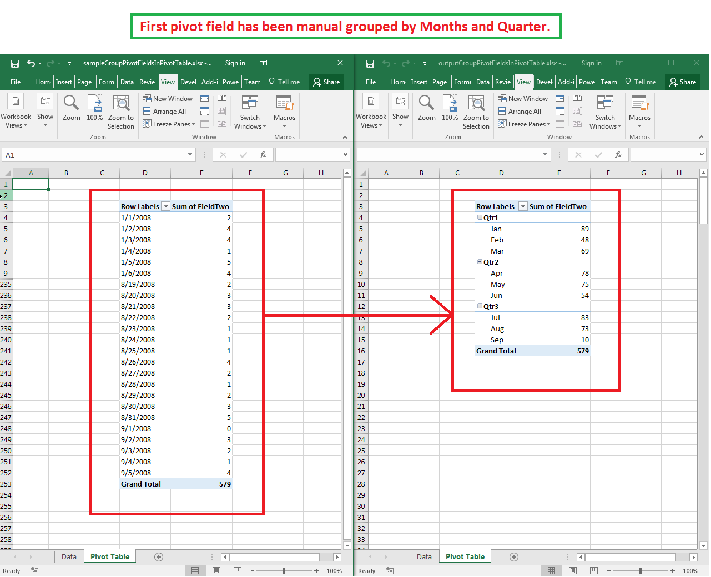

## **Possible Usage Scenarios**
- Grouping pivot fields is useful when a row or column field of a pivot table contains many distinct items, such as a date field with hundreds of dates or a numeric field with many scattered values. Grouping collapses these items into meaningful sections: dates into months, quarters and years, and numbers into ranges such as 0-1, 2-3, 4-5. This makes a large pivot table compact and easier to analyze. Aspose.Cells provides this capability through the `pivotField.group()` method (automatic grouping by data type) and `pivotField.group(PivotFieldGroupOptions)` (custom grouping options).
- Date grouping rolls the individual dates up into larger periods, such as days, months, quarters and years, and builds a time hierarchy (for example Years, Quarters, Months). Trends over time become visible at a glance, and each period level becomes its own pivot field in the row or column area of the pivot table.
- Grouping is available only for fields placed in the ROW or COLUMN area of a pivot table. A data (value) field cannot be grouped directly. To group such a field you must first add it to the row or column area of the pivot table.

## **Group Pivot Fields Automatically**
The parameterless `pivotField.group()` overload inspects the data type of the field and groups it automatically. A field that contains only dates (and blanks) is grouped by months. A field that contains only numbers (and blanks) is grouped into numeric ranges using an automatic interval.

```javascript
const AsposeCells = require("aspose.cells.node");
// Load the sample workbook
const wb = new AsposeCells.Workbook("sampleGroupPivotFieldsInPivotTable.xlsx");
// Access the second worksheet and its pivot table
const pt = wb.getWorksheets().get(1).getPivotTables().get(0);
// Group the first row field automatically.
// The field contains dates, so it is grouped by months.
const field = pt.getRowFields().get(0);
field.group();
// Calculate the pivot table data and save the output file
pt.calculateData();
wb.save("outputAutoGroupPivotField.xlsx");
```

## **Group Pivot Fields with Custom Options**
The `PivotFieldGroupOptions` class provides custom grouping configuration. For date fields, set `startDate`, `endDate`, and `groupTypes`. For numeric fields, set `startNumber`, `endNumber`, and `interval`. The `newPivotField` property controls whether grouping creates new pivot fields alongside the original (see the Note section at the end of this article).

### **Group a Date Field by Months and Quarters**
The following example groups the date row field of the sample pivot table by months and quarters between a start and end date. The code loads the [sample Excel file](sampleGroupPivotFieldsInPivotTable.xlsx), performs the grouping, calculates the pivot table data, and saves the grouped result. The screenshot shows the effect: the date row field is now grouped by quarters and months.
Note that the order of the values in `options.groupTypes` is ignored. No matter in which order the group types are listed, the grouped fields are always displayed from the largest period to the smallest: years, quarters, months, days, hours, minutes, seconds. In this example the months are listed before the quarters in `options.groupTypes`, yet the quarters are displayed as the outer level and the months as the inner level.

```javascript
const AsposeCells = require("aspose.cells.node");
let wb = new AsposeCells.Workbook("sampleGroupPivotFieldsInPivotTable.xlsx");
// Access the second worksheet and its pivot table
let pt = wb.getWorksheets().get(1).getPivotTables().get(0);
// Group the first row field (a date field) by months and quarters
let options = new AsposeCells.PivotFieldGroupOptions();
options.setStartDate(new Date(2008, 0, 1));
options.setEndDate(new Date(2008, 8, 5));
options.setGroupTypes([AsposeCells.PivotGroupByType.Months, AsposeCells.PivotGroupByType.Quarters]);
pt.getRowFields().get(0).group(options);
// Calculate the pivot table data and save the output file
pt.calculateData();
wb.save("outputGroupPivotFieldsInPivotTable.xlsx");
```



### **Group a Numeric Field into Ranges**
`FieldTwo` of the sample pivot table is initially a data (value) field. Because only row or column fields can be grouped, the code first calls `pivotTable.addFieldToArea(PivotFieldType.Row, "FieldTwo")` to move `FieldTwo` to the row area, refreshes the pivot, then groups the numeric field into the ranges 0-1, 2-3 and 4-5 using `startNumber = 0`, `endNumber = 5` and `interval = 2`.

```javascript
const AsposeCells = require("aspose.cells.node");
let wb = new AsposeCells.Workbook("sampleGroupPivotFieldsInPivotTable.xlsx");
// Access the second worksheet and its pivot table
let pt = wb.getWorksheets().get(1).getPivotTables().get(0);
// FieldTwo is a data field: move it to the row area first,
// because only row/column fields can be grouped
pt.addFieldToArea(AsposeCells.PivotFieldType.Row, "FieldTwo");
pt.calculateData();
// Group the numeric field into the ranges 0-1, 2-3, 4-5
let options = new AsposeCells.PivotFieldGroupOptions();
options.setStartNumber(0);
options.setEndNumber(5);
options.setInterval(2);
pt.getRowFields().get(1).group(options);
// Calculate the pivot table data and save the output file
pt.calculateData();
wb.save("outputNumberGroupPivotField.xlsx");
```

## **Note**

{}
- The `pivotField.groupBy()` method overloads are deprecated and removed from the API surface. `pivotField.group()` and `pivotField.group(PivotFieldGroupOptions)` are the replacements.
- In Microsoft Excel, grouping a numeric field REPLACES the original pivot field with the grouped ranges, while grouping a date field creates NEW pivot fields (one per group level, for example Quarters and Months) beside the original field. Starting with Aspose.Cells 26.10, the `pivotField.group()` methods follow the same behavior as Excel. The `pivotFieldGroupOptions.newPivotField` property exists for compatibility with older versions: it defaults to false for numeric grouping and true for date-time grouping; set it to false if you want date grouping to replace the original pivot field instead of creating new pivot fields.
- The `pivotFieldGroupOptions.interval` property takes effect only for numeric grouping and for date grouping by days (for example, grouping dates into 7-day periods); it is ignored when dates are grouped by months, quarters or years.
{}

## **Related Articles**
- [Add Row and Column Fields in Pivot Table](/cells/nodejs-cpp/pivot-table-add-row-and-column-fields/)
- [Filtering Pivot Tables by Label or Value](/cells/nodejs-cpp/filter-by-label-or-value-of-pivot-table/)
- [Add Page Field in Pivot Table](/cells/nodejs-cpp/add-page-field-in-pivot-table/)
- [Apply Style to Pivot Table](/cells/nodejs-cpp/apply-style-to-pivot-table/)
- [Refresh Pivot Table](/cells/nodejs-cpp/refresh-pivot-table/)

