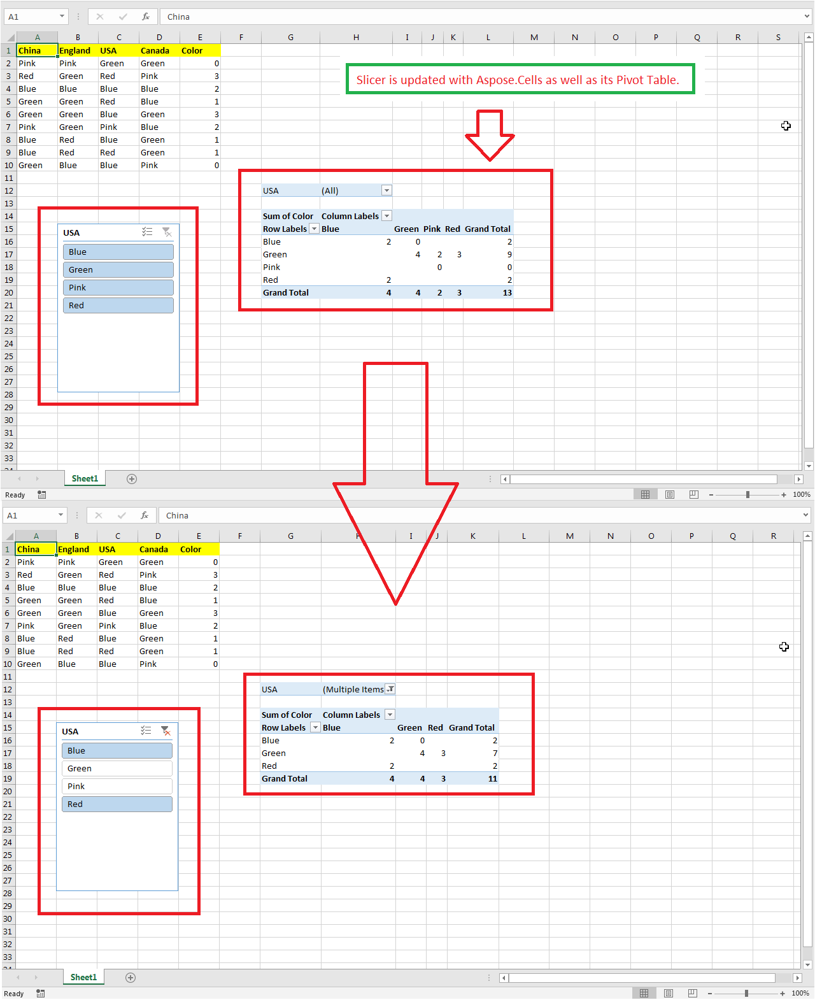

## **Possible Usage Scenarios**
Updating a slicer means filtering the data of the pivot table or table that the slicer is connected to. When you select or deselect slicer items in Microsoft Excel, the linked pivot table or table is recalculated accordingly. With Aspose.Cells for Python via .NET, you do not need to iterate the slicer cache items and refresh the slicer manually — the [**Slicer.select_items(labels, append)**](https://reference.aspose.com/cells/python-net/aspose.cells.slicers/slicer/selectitems/) method updates the slicer and recalculates the linked pivot table or table directly from the filter items:
- `Slicer.select_items(labels, append)` — selects the specified labels and recalculates the linked pivot table or table. When `append` is `True`, the originally selected labels are kept and the specified labels are added to the selection; when `append` is `False`, all original selections are cleared and only the specified labels stay selected.
- `Slicer.unselect_items(labels)` — unselects part of the currently selected items.
- `Slicer.clear_filter()` — removes the filter and selects all items.

{}
Starting from Aspose.Cells for Python via .NET 26.10, the `SlicerCacheItem.selected` property becomes read-only and its setter is no longer supported. Use the `Slicer.select_items`, `Slicer.unselect_items`, and `Slicer.clear_filter` methods instead of setting `SlicerCacheItem.selected` item by item.
{}

## **How to Update Slicer Using Aspose.Cells for Python Excel Library**
The following sample code loads the [sample Excel file](67338475.xlsx) that contains an existing slicer connected to a pivot table. It selects only the "Blue" and "Pink" items of the slicer with `Slicer.select_items(labels, False)` — the pivot table is recalculated directly from the filter items, without a manual `Slicer.refresh()` call. It then saves the workbook as the [output Excel file](67338476.xlsx). The following screenshot shows the effect of the sample code on the sample Excel file. As you can see in the screenshot, the pivot table shows only the filtered items.


## **Sample Code**
Replace the current selection (only the specified labels stay selected) and recalculate the linked pivot table or table:

```python
import aspose.cells as ac
# Load sample Excel file containing slicer.
workbook = ac.Workbook("sampleUpdatingSlicer.xlsx")
# Access first worksheet.
worksheet = workbook.worksheets[0]
# Access the first slicer inside the slicer collection.
slicer = worksheet.slicers[0]
# Select only "Blue" and "Pink"; the linked pivot table or table
# is recalculated directly from the filter items.
slicer.select_items(["Blue", "Pink"], False)
# Save the modified workbook.
workbook.save("out.xlsx")
```

Keep the currently selected labels and additionally select more items:

```python
# Keep the current selection and add "Red" to it.
slicer.select_items(["Red"], True)
```

Deselect part of the selected items:

```python
# Remove "Pink" from the current selection.
slicer.unselect_items(["Pink"])
```

Remove the filter (select all items):

```python
# Clear the filter; all slicer items become selected again.
slicer.clear_filter()
```

